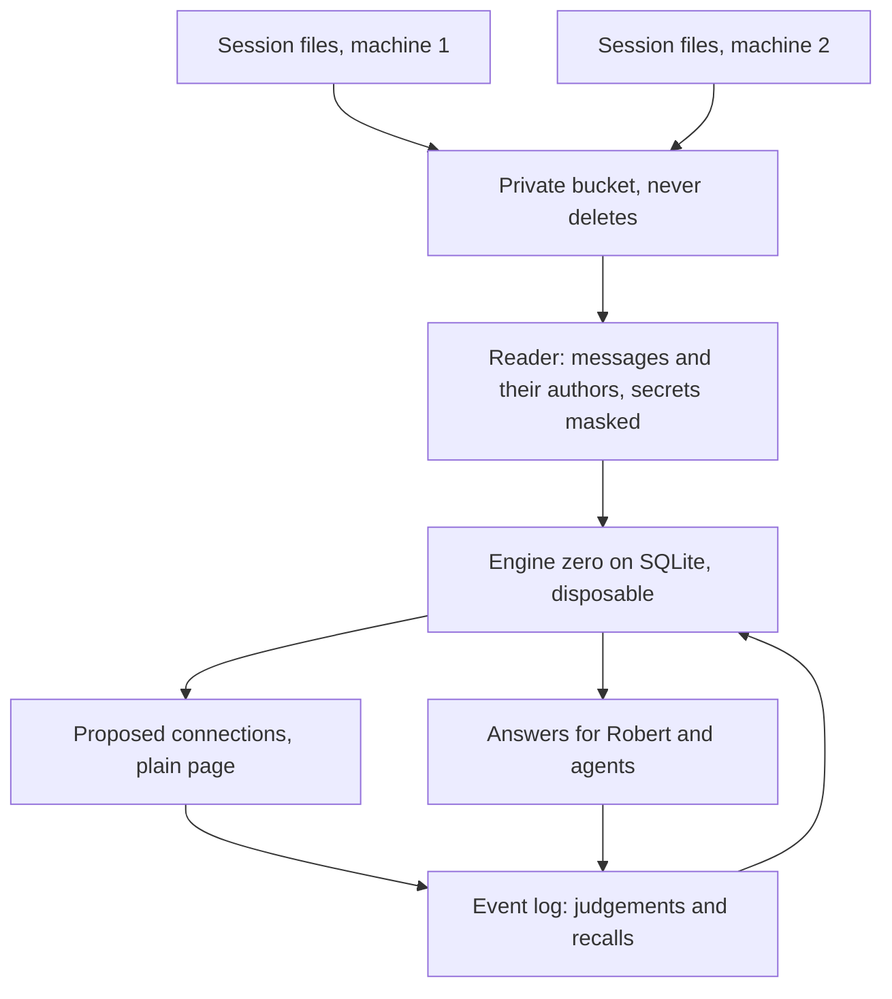
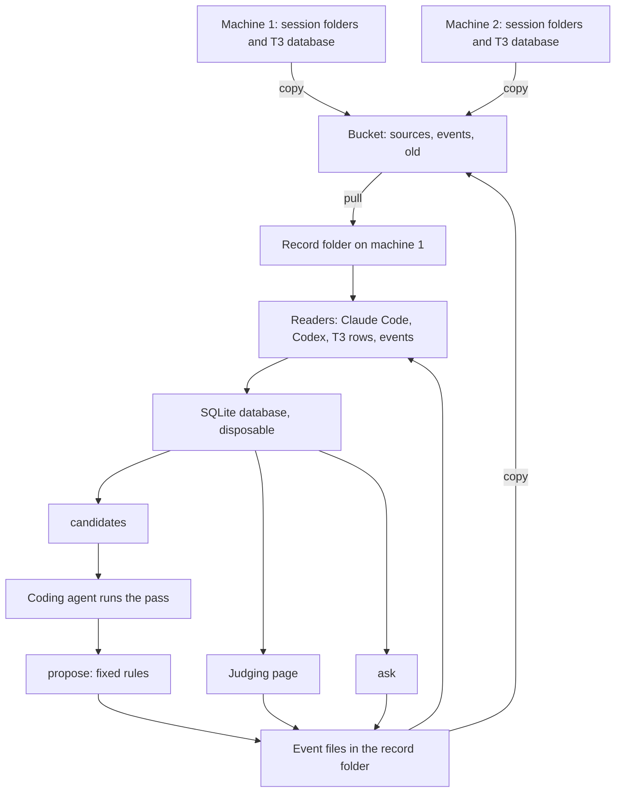
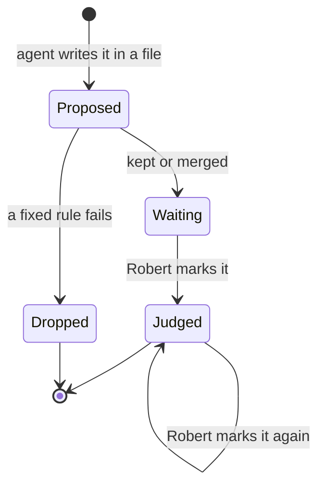

# Engine Zero - Plan

## Goal Capsule

- **Objective:** Connections between Robert's projects, which today exist only in Robert's head, are proposed by an agent from Robert's own agent sessions, judged by Robert, and kept. Nothing collected or judged is lost when the engine under it is replaced.
- **Means:** A throwaway first engine, written in Rust on SQLite, that reads agent session files from both of Robert's machines (KTD1).
- **Product authority:** Robert. The agent proposes; Robert decides.
- **Execution profile:** Ten units built in order, committed to `main` and pushed as each is finished, with no pull requests. This is the repository's practice, set by Robert on 15 November 2026.
- **Stop conditions:** Stop and ask Robert before any command that could delete or overwrite bucket content other than as KTD2 describes, before session text would go anywhere but the bucket, and when a step needs Robert.
- **Who finishes:** The agent builds and proves U1 to U8 and U10. Robert creates the bucket, sets up the second machine, and judges in U9.
- **Open blockers:** None. The first real run of U1 waits on the bucket and its credentials.

---

## Product Contract

### Summary

Engine zero copies Robert's agent session files to one private bucket, reads them into messages with their authors, stores them in SQLite, answers questions from Robert and their agents, and proposes connections across projects with evidence.
Robert judges each connection, and the judgements are kept in an event log outside the engine.
Its second job is to show which operations are slow or awkward, as evidence for a custom storage core.
It is built as one Rust command-line program beside rclone, and a coding agent runs the model step by calling it (KTD1, KTD11).

### Problem Frame

Robert has returned to one need for about two and a half years, in more than a dozen forms: a place where they and an agent think together across all projects, where nothing starts from zero.
Each earlier attempt kept its data inside the tool and started empty, so nothing built up across months.
The full reading is in `wiki/the-problem.md`.

Agent sessions are where most of Robert's thinking now happens, and the tools that write them delete them: Claude Code removes session files after 30 days unless told otherwise.
On one machine, 18 days of work produced 2.2 GB of Claude Code sessions and 650 MB of Codex sessions.

### Key Decisions

- **The sources and the judgements live outside the engine, and every engine is disposable.** Each earlier attempt lost its data with its tool. Governs R2, R3, R9, R13. (session-settled: user-approved — chosen over keeping data inside the engine: the engine can then be replaced without a restart)
- **The source is agent session files from both machines, copied to one bucket.** They already exist, are already append-only, and need no filing. Governs R1. (session-settled: user-directed — chosen over a new hand-kept record: Robert proposed it because the data and its append-only form already exist)
- **SQLite first; a custom storage core later.** Governs R3. (session-settled: user-directed — chosen over starting a custom storage core now: a working engine on real data shows what the core must be good at)
- **The project writes its own reader. cass is neither a dependency nor a fork.** Governs R4. (session-settled: user-directed — chosen over running cass: it would become a dependency)
- **Written in Rust.** Robert's choice. The one cost raised: a throwaway engine is slower to change in Rust than in a scripting language. It stands because the reader carries over to the next engine, which will also be Rust.
- **A model proposes; fixed rules decide.** A model that rewrites its own output drifts toward the generic, and fixed rules can be checked and repeated. Governs R11. Borrowed from cass-memory; see `wiki/existing-tools.md`.
- **No board in this version.** Robert judges connections on a plain page. Governs R12. (session-settled: user-approved — chosen over building shape B now: the board is drawn once there are connections worth drawing)
- **Robert judges real connections before the pipeline is finished.** Every earlier attempt was built and not used. Governs R20. (session-settled: user-approved — chosen over building the whole pipeline first: judging the hand-run connections tests the idea at almost no build cost)
- **The reader stores messages only.** Governs R6. (session-settled: user-approved — chosen over extracting decisions and attempts in the reader: those need a model, and a reader without one can be rerun and checked)
- **Secrets are masked in what the engine stores; the bucket stays raw.** Governs R17, R18. (session-settled: user-approved — chosen over relying on the private bucket alone: session text also reaches agents, the model step and the page)
- **A session with no repository counts as its own context.** Governs R10, R11, R16. (session-settled: user-approved — chosen over leaving such sessions unknown until Robert assigns them: a third of the messages Robert typed on the first machine are in them, and assigning them is filing by hand)
- **Agents asking the engine stays in this version and is built last.** Governs R8, R9, R21. (session-settled: user-approved — chosen over cutting it: it is cheap once the database exists, and without it the tool serves only the person's half of the need)

<!-- ce-section: work-relationships -->
### How This Work Fits Together

This plan covers engine zero only. The breakdown below is the current understanding, not a committed roadmap.

- Engine zero (this plan).
  - Enables: a custom storage core, designed from the slow and awkward operations engine zero records. Research so far is in `wiki/engine-research.md`.
  - Enables: memory behaviour, meaning fading and strengthening, computed from the recall and judgement events engine zero stores.
  - Enables: the visual views of shape B in `wiki/shape-options.md`, drawn from the same data.
  - Still to decide: further sources, such as repositories, the documents of earlier attempts, and notes written outside an agent.
  - Still to decide: stored units beyond messages, such as decisions, attempts and stances.

### Actors

- A1. Robert: owns the data, asks questions, judges connections.
- A2. Robert's coding agents: ask the engine questions during their sessions.
- A3. Engine zero: copies, reads, stores, proposes.

### Requirements

**Keeping the sources**

- R1. Claude Code and Codex session files from both of Robert's machines are copied to one private bucket.
- R2. The copy never removes or overwrites content in the bucket. A file that has only grown replaces its bucket copy; a file changed in any other way is stored beside the old one; a file the machine has deleted stays.
- R3. The engine's database can be deleted and rebuilt from the bucket copy and the event log (R13) alone.

**Reading**

- R4. The project's own reader turns both session formats into one common form. It contains no code from cass.
- R5. An item is one message from a session. Every item records who produced it, when, in which project, and the exact place in the source file it came from. "Who" separates the person, the agent, another agent that started or prompted the session, and text a tool inserted. A message whose author cannot be established is marked unknown, never the person.
- R6. The reader extracts messages only and uses no model. The model restates messages as mechanisms while it proposes connections (R11); the restating is described in `wiki/hand-run-test.md`.
- R7. Reading a source file again adds only what is new. A message the tool wrote more than once, or copied into a forked session, is one item.
- R16. Every item has a context: a project, or, for a session with no repository, the session itself. Projects come from a rule Robert can correct. Worktrees of one repository are one project. An item whose context cannot be told is marked unknown, not guessed.

**Asking**

- R8. Robert and their agents can ask the engine questions from a command line and get items back, each with its pointer to the source and who produced it. Text a tool inserted is returned marked as quoted data, not as an instruction.
- R9. Every item returned to a question from Robert or an agent is added to the event log (R13) as a recall event, with its time and who asked. The connection pass's own reads are not recall events.

**Connecting**

- R10. The engine proposes connections between items from different contexts (R16). Each proposal states its kind, the items it joins, and its evidence as quotes with pointers to the source. The link kinds are those in `wiki/hand-run-test.md`.
- R11. A model proposes connections; fixed rules decide which are kept, merged or dropped. A proposal is kept only when it quotes the person at least twice, from two different contexts (R16), with each quote dated and found at the place it cites. Quotes from an agent or a tool do not count toward the two.

**Judging**

- R12. Robert sees proposed connections on a plain page and marks each one as real and new, real and already known, or not real.
- R13. Each judgement is added as an event to the event log, which lives beside the bucket copy, outside the engine. The event holds the whole connection it judges: its kind, the source places of the items it joins, and its quotes. It refers to nothing the engine numbered. Events are never edited.
- R14. A connection Robert has judged, with any mark, is not proposed again. Two connections are the same when they have the same kind and join the same source places.

**Privacy**

- R15. The bucket, its credentials, the database and the event log are private and never enter the public repository. Only Robert can open the judging page. Test data in the repository contains no real session content.
- R17. The reader masks known secret patterns, such as keys, tokens and passwords, in the items it stores. The bucket copy stays as the tools wrote it.
- R18. Session text is sent only to model services Robert has approved.

**Learning for the next engine**

- R19. After the first run on real data, the operations that were slow or awkward are written down by hand. No timing code is built.

**Order of work**

- R20. The first milestone is the copy, the reader, the page, and Robert judging the connections from the hand-run test with some false connections mixed in. The copy is built first.
- R21. Asking (R8, R9) is built last.



### Key Flows

- F1. Collect and read
  - **Trigger:** A regular run on each machine.
  - **Actors:** A3
  - **Steps:** New and grown session files are copied to the bucket. The reader turns what is new into items.
  - **Covered by:** R1, R2, R4, R5, R6, R7, R16, R17
- F2. Propose connections
  - **Trigger:** A regular pass, or Robert asks for one.
  - **Actors:** A3
  - **Steps:** A model restates messages as mechanisms and proposes connections across contexts. Fixed rules check the evidence and keep, merge or drop each one. Kept proposals appear on the page.
  - **Covered by:** R10, R11, R14, R18
- F3. Judge
  - **Trigger:** Robert opens the page.
  - **Actors:** A1
  - **Steps:** Robert reads a connection, opens its evidence if they wish, and marks it. The mark is added to the event log.
  - **Covered by:** R12, R13, R15
- F4. Ask
  - **Trigger:** Robert or an agent has a question, for example at the start of a session.
  - **Actors:** A1, A2
  - **Steps:** The question goes to the engine. Items come back with source pointers and who produced each. Each returned item is added to the event log as a recall event.
  - **Covered by:** R8, R9
- F5. Rebuild
  - **Trigger:** The engine is replaced or its database is lost.
  - **Actors:** A1, A3
  - **Steps:** The database is built again from the bucket copy and the event log. Every judgement and every recall event is present afterwards.
  - **Covered by:** R3, R9, R13
- F6. First judging
  - **Trigger:** The copy, the reader and the page exist.
  - **Actors:** A1, A3
  - **Steps:** The connections from the hand-run test are put on the page with some false connections mixed in. Robert marks each one. The marks go to the event log and give the first baseline.
  - **Covered by:** R12, R13, R20

### Acceptance Examples

- AE1. **Covers R2.** Given a session file is in the bucket, when that file is deleted from the machine and the copy runs again, the file is still in the bucket.
- AE2. **Covers R3, R9, R13.** Given Robert has judged ten connections and the engine has answered questions, when the database is deleted and rebuilt, all ten judgements and all recall events are present, and each judgement is shown with the connection it judged.
- AE3. **Covers R5.** Given a session where a tool inserted a report into the person's turn, when the reader runs, that report is not recorded as something the person said.
- AE4. **Covers R7.** Given a session file that has grown by three messages since it was last read, when the reader runs, each of the three is added once; when it runs again, nothing is added.
- AE5. **Covers R11.** Given a proposal whose only quotes are an agent's words, or whose quote is not at the place it cites, when the rules run, the proposal is dropped and never reaches the page.
- AE6. **Covers R14.** Given a connection Robert has judged, with any mark, when a later pass proposes the same connection, even after a rebuild, it does not reach the page.
- AE7. **Covers R5.** Given a subagent session opened by a parent agent's prompt, when the reader runs, that prompt is recorded as another agent's and not as something the person said.
- AE8. **Covers R2.** Given a session file whose earlier content has changed on the machine, when the copy runs, the bucket holds both the old file and the new one.
- AE9. **Covers R16.** Given two sessions in two worktrees of one repository, when the reader runs, their items carry the same project.
- AE10. **Covers R17.** Given a message that contains an API key, when the reader runs, the stored item shows the key masked and the bucket file is unchanged.
- AE11. **Covers R11, R16.** Given two of Robert's quotes from two different sessions that have no repository, when the rules run, the proposal can be kept; given both quotes from one such session, it is dropped.

### Success Criteria

- The share of connections Robert marks real and new is measured from the first judging (R20), with false connections mixed in as the precision test in `wiki/hand-run-test.md` describes. No target is set; the first judging gives the baseline.
- Robert is still using it 60 days after the first judging, having filed nothing by hand.
- The list in R19 exists.

### Scope Boundaries

Deferred for later:

- The board, timeline and status views of shape B.
- Fading and strengthening of memories. Engine zero only stores the events they will be computed from (R9, R13).
- Sources other than Claude Code and Codex sessions.
- Decisions, attempts and stances as stored units.
- A custom storage core.
- Removing secrets from session files before they are copied.
- Use from a phone or tablet.

Outside this product's identity:

- Rules that teach coding agents how to code. That is the problem cass-memory solves.
- A note-taking or personal knowledge management tool.
- More than one person's data.

### Deferred to Follow-Up Work

- Asking the engine from the second machine (A2).
- Loading tool call inputs and results into the database (A1).

Considered and not built:

- Write-once pieces in the bucket with an R2 bucket lock, so that the server itself refuses overwrites and deletes. It needs more copy code and a reader that joins pieces. The backup folder's cost, or any lost bucket file, would change this.
- A model client inside the engine. A coding agent already runs the pass (KTD11). A need to run passes with no agent session would change this.
- Matching T3 rows by similar text when the hash fails. A large unknown share reported by the reader would change this.
- A way to change a mark on the page. A later judgement already holds (KTD9). Robert asking for it would change this.

### Dependencies / Assumptions

- Robert provides a private bucket and its credentials when the copy is built. rclone is installed on both machines then.
- Who sent a prompt through T3 Code can be told only from T3 Code's own database, measured on the first machine on 16 November 2026. Whether T3 Code runs on the second machine is unverified.
- Session files hold secrets and go to the bucket as they are. A private bucket is assumed to be enough for the raw copy. The bucket never deletes, so a secret copied in stays there.
- Claude Code's session retention is set to 100 years on the first machine, done on 15 November 2026. It must also be set on the second machine.
- It is unverified whether session files older than 30 days still exist on the second machine. The plan does not depend on them.
- It is unverified whether Codex deletes old session files.
- Both formats are JSON lines with different shapes. On the first machine, 1,255 of 1,534 Claude Code session files are subagent sessions, counted on 16 November 2026.
- It is unverified that either tool only appends to its session files.
- The connections from the hand-run test are in Robert's private notes, outside the repository.
- The first judging covers only the weeks of sessions still on disk, so a low share may reflect the short window and not the approach.
- The project's north star is unconfirmed. These success criteria stand in for it.

### Outstanding Questions

Deferred to implementation:

- Whether T3 Code runs on the second machine, and what share of prompts there stay unknown.
- Whether exe.dev's proxy reaches a page that listens on the local address only.
- Whether `tiny_http` is still maintained when U8 is built.
- How a prompt that starts with a slash command appears in T3 Code's row and in the session file, since the hash match needs the same text.

### Sources / Research

- `wiki/the-problem.md`: the need, why it recurs, the split between record, engine and view, and the size measurements.
- `wiki/hand-run-test.md`: unit kinds, link kinds, the operations that found connections by hand, and four tests.
- `wiki/existing-tools.md` and `raw/sources/2026-11-15-cass.md`: what cass and cass-memory do, the four ideas borrowed, and the licence rider that rules out copying their code.
- `wiki/engine-research.md`: research on engines and storage cores that engine zero's measurements feed.
- `wiki/memory-model.md`: the decision that the data is linked structure plus memory behaviour.

---

## Planning Contract

Product Contract preservation: changed R5, R10, R11 and R16, and added AE11.
R5 gains the author "unknown", because research showed some prompts cannot be attributed.
R10, R11 and R16 now speak of contexts, because Robert decided on 16 November 2026 that a session with no repository counts on its own.

### Key Technical Decisions

- KTD1. **One Rust command-line program beside rclone.** It has no async runtime and no model client. Libraries: `rusqlite` with its bundled SQLite, which has full-text search switched on, `serde_json`, `clap`, `regex`, `sha2` and `tiny_http`. Governs R3, R4.
- KTD2. **The copy is `rclone copy` with a dated backup folder, called only by the program.** Before rclone overwrites a bucket file it moves the old version into `old/<time>/`, so grown files and rewritten files are both kept without the program comparing content. The program never calls `rclone sync` and never passes a delete flag. Governs R1, R2.
- KTD3. **The engine reads a local record folder that mirrors the bucket.** The engine machine pulls `sources/` and `events/` from the bucket and reads only that folder, so a rebuild uses exactly what the bucket holds. Governs R3. Layout is under Output Structure.
- KTD4. **A small extract of T3 Code's database is copied with the session files.** Neither tool's session file shows whether a person or an agent sent a prompt through T3 Code; T3 Code's `orchestration_v2_projection_messages` table does, in `createdBy`. Each machine appends one row per user-role T3 message to `sources/<machine>/t3/messages.jsonl`: message id, thread id, the provider's session id, `createdBy`, `creationSource`, time, and the SHA-256 of the trimmed text. A second file lists T3 Code's project roots. The extract holds no message text. Governs R5, R16.
- KTD5. **A message is the person's only on positive evidence.** The evidence is a T3 row with `createdBy: user` whose text hash matches within the linked session, or a terminal session record marked human. Everything else is the agent, another agent, a tool, or unknown. The ordered checks are in the tables under High-Level Technical Design. Governs R5.
- KTD6. **An item's key comes from the source, not the engine.** Claude Code: `claude:<uuid>`. Codex: `codex:<session id>:<ordinal>`. The file path and line number are stored beside the key as the place. When a key appears twice, the first file wins. Codex fork copies and `compacted` records are skipped. Governs R5, R7, R13.
- KTD7. **Reading resumes from a byte position per file.** Only complete lines are read. A line that fails to parse is skipped and counted, because Codex has broken lines in the middle of files. The unique key makes a second read add nothing. A file shorter than its saved position is read again from the start. Governs R7.
- KTD8. **The context of an item is decided by an ordered rule.** First match wins:
  1. a correction Robert has recorded for a path prefix;
  2. the last segment of Codex's `git.repository_url`;
  3. a worktree path, which names its repository: `.t3/worktrees/<repo>/…` or `<repo>/.claude/worktrees/…`;
  4. a T3 Code scratch folder or a temporary folder, which makes the session its own context;
  5. the longest known project root that contains the working directory, named by its folder;
  6. any other working directory, which makes the session its own context;
  7. no working directory, which gives unknown.
  Known project roots come from the T3 extract and from the machine's config. Governs R16.
- KTD9. **The event log is one JSON-lines file per machine per month, and the database derives from it.** Events have four kinds: proposal, judgement, recall and context correction. Writing an event appends a line to `events/<machine>/<YYYY-MM>.jsonl` and then reads it in through the same loop that reads session files. A rebuild is that loop run on an empty database. When one connection has two judgements, the later one holds. Governs R3, R9, R13.
- KTD10. **A connection's identity is its kind plus the sorted keys of the items it joins, and the fixed rules run in this order.** Governs R11, R14.
  1. Drop when the kind is not one of the six in `wiki/hand-run-test.md`.
  2. Drop when any quote is not found in its cited item. Runs of whitespace compare as one space.
  3. Drop when fewer than two quotes come from items the person wrote that carry a time.
  4. Drop when those quotes come from fewer than two contexts. An item with unknown context counts toward none.
  5. Drop when a connection with the same identity has been judged.
  6. Merge when a connection with the same identity is already waiting.
  7. Otherwise keep, by writing a proposal event.
- KTD11. **A coding agent runs the model step and calls the program.** `candidates` prints the person's messages; the agent restates and proposes in a file; `propose` applies KTD10. The procedure is `engine-zero/passes/connection-pass.md`. The engine sends session text nowhere, so text reaches only the agent Robert starts the pass in. Governs R6, R10, R18.
- KTD12. **The page is served by the program and reached through exe.dev's private proxy.** It is plain server-rendered HTML with one form per connection and a hidden token made at start. exe.dev serves ports 3000 to 9999 only to people with access to the machine; the port is never set public. Governs R12, R15.
- KTD13. **Masking runs before anything is stored, with a fixed list of patterns.** Quotes are checked against the masked text, so the event log holds masked text only. The list covers cloud and model-service key shapes, token prefixes, private key blocks, bearer headers, and `password=`-style assignments; gitleaks' default rules are the reference for the shapes. Governs R17.
- KTD14. **Private files live outside the repository, and the program refuses to run otherwise.** Config is in `~/.config/engine-zero/`, the record folder and database in `~/.local/share/engine-zero/`, and bucket credentials in rclone's own config. Governs R15.

### Assumptions

These are the planner's choices that Robert has not confirmed.

- A1. The reader stores the person's messages, the agent's text replies, prompts from other agents, prompts of unknown author, and reports a tool delivered in the user's turn. It does not store tool call inputs and results, thinking, text the harness injected, compaction summaries or request copies. They stay in the bucket, and a later reader can add them.
- A2. The engine runs on the first machine only. The second machine runs the copy. Agents on the second machine do not ask the engine in this version.
- A3. The copy runs once a day on each machine, and whenever Robert or the agent starts it.
- A4. The same folder name on two machines means the same project. A correction (KTD8, step 1) handles the exceptions.
- A5. A terminal session prompt with no human marker is unknown, as older Claude Code versions wrote no marker.
- A6. The engine does not check which agent runs the connection pass. Robert chooses by starting it.

### High-Level Technical Design



Who wrote a Claude Code record. First match wins.

| Step | Check | Result |
| --- | --- | --- |
| 1 | Record type is neither `user` nor `assistant` | Not stored |
| 2 | `assistant` record with a `text` block | Agent |
| 3 | `assistant` record with any other block | Not stored |
| 4 | `user` record carrying a tool result (`tool_result` block, `toolUseResult` or `sourceToolAssistantUUID`) | Not stored |
| 5 | `user` record with `isMeta` or `isCompactSummary` | Not stored |
| 6 | File is under `subagents/` | Another agent |
| 7 | `origin.kind` is `coordinator` or `peer` | Another agent |
| 8 | T3 row for this session with the same text hash and `createdBy: user` | Person |
| 9 | T3 row for this session with the same text hash and `createdBy: agent` | Another agent |
| 10 | `origin.kind: human`, `promptSource: typed` or `turnOrigin: human` | Person |
| 11 | `origin.kind: task-notification`, or text that opens with a task notification or command output wrapper | Tool |
| 12 | Anything else | Unknown |

Who wrote a Codex record. First match wins.

| Step | Check | Result |
| --- | --- | --- |
| 1 | `ordinal` below `subagent_history_start_ordinal`, or `metadata.inherited_user_message`, or type `compacted` | Not stored |
| 2 | `event_msg` `item_completed` with item type `AgentMessage` | Agent |
| 3 | `response_item` `agent_message` addressed to this session's agent | Another agent |
| 4 | `item_completed` `UserMessage` with a T3 row: `createdBy: user` | Person |
| 5 | `item_completed` `UserMessage` with a T3 row: `createdBy: agent` | Another agent |
| 6 | `item_completed` `UserMessage`, no T3 row, `originator` is `codex-tui` | Person |
| 7 | Any other `item_completed` `UserMessage` | Unknown |
| 8 | Anything else | Not stored |

A connection moves through these states. Each arrow except the drops is an event in the log.



### Output Structure

In the repository:

```text
engine-zero/
  Cargo.toml
  README.md
  passes/connection-pass.md
  src/
    main.rs      command line
    config.rs    private paths and the refusal in KTD14
    copy.rs      rclone calls
    t3.rs        T3 extract
    store.rs     schema and queries
    ingest.rs    the reading loop
    mask.rs
    claude.rs    Claude Code reader
    codex.rs     Codex reader
    context.rs
    events.rs
    propose.rs
    page.rs
    ask.rs
  tests/
    fixtures/    made-up sessions and a made-up T3 database
```

In the bucket, and mirrored in the record folder except `old/`:

```text
sources/<machine>/claude/…        as Claude Code wrote it
sources/<machine>/codex/…         as Codex wrote it
sources/<machine>/t3/messages.jsonl
sources/<machine>/t3/projects.jsonl
events/<machine>/<YYYY-MM>.jsonl
old/<time>/…                      versions rclone moved aside
```

### Risks

| Risk | What limits it |
| --- | --- |
| T3 Code changes its database tables. | The extract fails loudly and the file copy still runs. Prompts read meanwhile are unknown, never the person's, and are settled on a later read. |
| The text-hash match misses a prompt T3 Code or the tool rewrote. On the first machine 28 Claude Code and about 7 Codex prompts matched no row, and 14 typed messages exist only as queue records. | Those are unknown. The count is reported by the reader so the loss is visible. |
| Masking misses a secret of an unusual shape. | Only the person's and agents' prose is stored, not tool output, where most secrets are. The page and the event log are private. |
| A wrong rclone command deletes bucket files. | The program is the only caller and has no delete path. The backup folder keeps every overwritten version. |
| The backup folder grows, because each run keeps the old version of every file that grew. | One run a day. If the cost matters, the write-once design under Scope Boundaries replaces it. |
| Some hand-run connections drew on repositories, not sessions, and cannot pass KTD10. | They are listed for Robert and not forced onto the page. |
| The stored text is small, about 0.2 MB of the person's words on the first machine, so few operations will be slow. | R19 records that as a finding. |

### Sources / Research

- Session format facts were measured on all files on the first machine on 16 November 2026. The full notes are machine-local at `~/code/shared-whiteboard-private/session-formats.md`. They are not needed to build: the tables above govern.
- Measured there: 2.26 GB in 1,537 Claude Code files and 0.65 GB in 642 Codex files; 281 Claude Code files are main sessions; 178 of those and 510 Codex files link to a T3 thread.
- Measured there: of plain prompts in T3-linked sessions, 736 Claude Code and 239 Codex prompts were the person's, and 198 of each were an agent's.
- Records to skip in Claude Code files: `api-request`, `api-request-blob`, `api-request-shape`, `attachment`, `queue-operation`, `last-prompt`, `ai-title`, `custom-title`, `mode`, `permission-mode`, `file-history-snapshot`, `file-history-delta`, `fork-context-ref`, `system` and the other metadata types.
- The link from a T3 thread to a provider session is `orchestration_v2_projection_provider_threads.payload_json.nativeThreadRef.nativeId`. T3 Code's database is `~/.t3/userdata/statev2.sqlite`, opened read-only.
- rclone's `--backup-dir` moves files that would be overwritten into another folder on the same remote: https://rclone.org/docs/#backup-dir-string
- exe.dev serves ports 3000 to 9999 only to people with access to the machine: https://exe.dev/docs/proxy.md
- A check of 344 recent session files over 16 minutes found 5 that grew and none whose earlier content changed. It is too short to prove the tools only append.

---

## Implementation Units

| Unit | Title | Main files | Depends on |
| --- | --- | --- | --- |
| U1 | Program skeleton and the copy | `engine-zero/src/copy.rs`, `engine-zero/src/t3.rs`, `engine-zero/src/config.rs` | none |
| U2 | Store and the reading loop | `engine-zero/src/store.rs`, `engine-zero/src/ingest.rs`, `engine-zero/src/mask.rs` | U1 |
| U3 | Claude Code reader | `engine-zero/src/claude.rs` | U2 |
| U4 | Codex reader | `engine-zero/src/codex.rs` | U2 |
| U5 | Contexts | `engine-zero/src/context.rs` | U3, U4 |
| U6 | Event log and rebuild | `engine-zero/src/events.rs` | U2 |
| U7 | Proposals and the fixed rules | `engine-zero/src/propose.rs`, `engine-zero/passes/connection-pass.md` | U5, U6 |
| U8 | Judging page | `engine-zero/src/page.rs` | U7 |
| U9 | First judging | `wiki/engine-zero-notes.md` | U1 to U8 |
| U10 | Asking | `engine-zero/src/ask.rs` | U6 |

### U1. Program skeleton and the copy

- **Goal:** Session files from a machine reach the bucket, nothing in the bucket is lost, and the first machine can pull the bucket into its record folder.
- **Requirements:** R1, R2, R15, R20; AE1, AE8; KTD1, KTD2, KTD3, KTD4, KTD14.
- **Dependencies:** None in code. Robert provides the bucket and its credentials.
- **Files:** `engine-zero/Cargo.toml`, `engine-zero/src/main.rs`, `engine-zero/src/config.rs`, `engine-zero/src/copy.rs`, `engine-zero/src/t3.rs`, `engine-zero/tests/copy.rs`, `engine-zero/tests/t3.rs`, `engine-zero/tests/fixtures/t3/`, `engine-zero/README.md`, `.gitignore`, `AGENTS.md`.
- **Approach:**
  1. `copy` writes the T3 extract, then copies each source folder and this machine's event files to the bucket.
  2. `pull` copies `sources/` and `events/` from the bucket into the record folder.
  3. When T3 Code's database is absent, the extract is skipped. When its tables are not the expected ones, the file copy still runs and the command ends with an error.
  4. `engine-zero/README.md` gives the install, config and daily schedule steps for both machines. The schedule on the first machine is installed in this unit.
  5. `AGENTS.md` gains a layout row for `engine-zero/`, and `.gitignore` excludes the build folder.
- **Execution note:** rclone is not installed on the first machine. Install it first, and prove the flags on local folders before the first run against the real bucket.
- **Test scenarios:** The tests run rclone between local folders. That catches wrong flags and layout and misses behaviour particular to R2, which the first real run checks.
  - Covers AE1. A file is copied, deleted at the source, and the copy runs again: the file is still at the destination.
  - Covers AE8. Earlier bytes of a copied file change at the source and the copy runs: the destination holds the new file and `old/` holds the previous one.
  - A copied file grows: the destination holds the grown file and `old/` holds the shorter one.
  - A second run with no changes transfers nothing.
  - `pull` into an empty record folder reproduces `sources/` and `events/` and leaves `old/` out.
  - The T3 extract from a made-up database has one row per user-role message and contains no message text.
  - A second extract run appends nothing; one new T3 message appends one row.
  - With no T3 database, `copy` succeeds.
  - With unexpected T3 tables, the files are copied and the command ends with an error.
  - A config whose record folder or database is inside the repository is refused.
- **Verification:** After the first real run, the bucket lists both source trees and the T3 extract for the first machine. A second run moves only files that grew. The daily schedule is in place.

### U2. Store and the reading loop

- **Goal:** Record files become rows once each, however often the reader runs.
- **Requirements:** R3, R7, R17; AE4, AE10; KTD6, KTD7, KTD13.
- **Dependencies:** U1.
- **Files:** `engine-zero/src/store.rs`, `engine-zero/src/ingest.rs`, `engine-zero/src/mask.rs`, `engine-zero/tests/ingest.rs`, `engine-zero/tests/mask.rs`.
- **Approach:** The database holds source files with their byte position, items with a full-text index, T3 authorship rows, and events. `read` walks the record folder and hands each new line to the reader for its tree. Text is masked on the way in.
- **Test scenarios:**
  - Covers AE4. A file grows by three messages: three items are added; a second read adds none.
  - A last line with no newline is left alone, and is added once after it is completed.
  - A broken line in the middle of a file is skipped and counted, and the lines after it are read.
  - A file shorter than its saved position is read from the start and no item is duplicated.
  - One key in two files gives one item, with the first file's path.
  - Covers AE10. A message with an API-key-shaped string is stored masked, and the source file's bytes are unchanged.
  - Each masking pattern has one string it masks and one near miss it leaves, such as a git commit hash.
  - A word in a stored item is found by full-text search.
- **Verification:** A read of the first machine's record folder finishes, and a second read reports nothing new.

### U3. Claude Code reader

- **Goal:** Claude Code records become items with the right author, time, working directory and place.
- **Requirements:** R4, R5, R6; AE3, AE7; KTD5, KTD6; A1, A5.
- **Dependencies:** U2.
- **Files:** `engine-zero/src/claude.rs`, `engine-zero/tests/reader_claude.rs`, `engine-zero/tests/fixtures/claude/`.
- **Approach:** Apply the Claude Code table under High-Level Technical Design. On every read, try again to settle unknown prompts in T3-linked sessions, because a T3 row can arrive after the prompt was read.
- **Test scenarios:**
  - Covers AE7. The opening prompt of a file under `subagents/` is another agent's.
  - Covers AE3. A task notification in the user's turn is a tool's.
  - A record carrying a tool result is not stored.
  - A record with `isMeta`, and a compaction summary, are not stored.
  - A plain prompt whose hash matches a T3 row with `createdBy: user` is the person's; with `createdBy: agent` it is another agent's.
  - A plain prompt in a T3-linked session with no matching row is unknown, and becomes the person's on a later read once the row exists.
  - A plain prompt in an SDK session with no T3 link is unknown.
  - A terminal prompt with a human marker is the person's; without one it is unknown.
  - An assistant `text` block is the agent's; thinking and tool calls are not stored.
  - `api-request-blob` copies of a message add no item.
  - An item carries its time, working directory, file path, line number and a key made from `uuid`.
- **Verification:** On the first machine no item from a `subagents/` file is the person's, and the count of the person's Claude Code items is close to the 736 measured.

### U4. Codex reader

- **Goal:** Codex records become items under the same rules, with each prompt stored once.
- **Requirements:** R4, R5, R6, R7; KTD5, KTD6; A1.
- **Dependencies:** U2.
- **Files:** `engine-zero/src/codex.rs`, `engine-zero/tests/reader_codex.rs`, `engine-zero/tests/fixtures/codex/`.
- **Approach:** Apply the Codex table under High-Level Technical Design. Take the working directory and repository URL from `session_meta`.
- **Test scenarios:**
  - A `UserMessage` item whose hash matches a T3 row with `createdBy: user` is the person's; with `createdBy: agent` it is another agent's.
  - A `UserMessage` item with no T3 row is the person's when `originator` is `codex-tui`, and unknown otherwise.
  - A prompt written both as a `UserMessage` item and as a user `response_item` gives one item.
  - In a forked file, records below the history start are skipped and the parent's messages are not duplicated.
  - A `compacted` record adds no item.
  - An `agent_message` addressed to the session's agent is another agent's.
  - An `AgentMessage` item is the agent's; developer messages, injected context, reasoning and tool calls are not stored.
  - An item's key is the session id and `ordinal`.
- **Verification:** On the first machine the count of the person's Codex items is close to the 239 measured, and no fork copy is stored.

### U5. Contexts

- **Goal:** Every item has a context: a project, its own session, or unknown.
- **Requirements:** R16; AE9, AE11; KTD8; A4.
- **Dependencies:** U3, U4.
- **Files:** `engine-zero/src/context.rs`, `engine-zero/tests/context.rs`.
- **Approach:** Apply KTD8 when an item is stored. `context set` records a correction as an event and relabels the items it covers.
- **Test scenarios:**
  - Covers AE9. Two sessions in two worktrees of one repository get the same project, for both worktree path shapes.
  - A subfolder of a known project root gets that project.
  - A Codex repository URL decides the project when the path would give another name.
  - Two sessions in two scratch folders get two different contexts.
  - The scratch root in T3 Code's project list is not treated as a project.
  - A session in a temporary folder is its own context.
  - A record with no working directory is unknown.
  - A correction for a path prefix relabels the items under it and holds after a rebuild.
- **Verification:** On the first machine, the list of contexts with their item counts shows each repository once.

### U6. Event log and rebuild

- **Goal:** Events are appended outside the database, and the database can be thrown away and rebuilt.
- **Requirements:** R3, R9, R13; AE2; KTD9.
- **Dependencies:** U2.
- **Files:** `engine-zero/src/events.rs`, `engine-zero/tests/rebuild.rs`.
- **Approach:** One function appends an event line and reads it in. `rebuild` deletes the database and runs `read`.
- **Test scenarios:**
  - Appending an event adds one line to this machine's file for the current month and leaves the earlier lines byte-for-byte the same.
  - Covers AE2. With ten judgements and several recall events, a rebuild gives the same counts, and each judgement shows its connection's kind, places and quotes.
  - A database rebuilt from the record folder has the same item counts by author and event counts by kind as the one built step by step.
  - Two judgements for one connection: the later one holds.
  - Events in another machine's folder are read as well.
- **Verification:** A rebuild on the first machine's real record folder gives the same counts as before it.

### U7. Proposals and the fixed rules

- **Goal:** An agent can propose connections, and only those that pass the rules reach the page.
- **Requirements:** R6, R10, R11, R14, R18; AE5, AE6, AE11; KTD10, KTD11; A6.
- **Dependencies:** U5, U6.
- **Files:** `engine-zero/src/propose.rs`, `engine-zero/passes/connection-pass.md`, `engine-zero/tests/propose.rs`.
- **Approach:**
  1. `candidates` prints the person's items with key, time, context and masked text, optionally from a date.
  2. `propose` reads a file of proposals, applies KTD10, and prints for each one whether it was kept, merged or dropped, and why.
  3. A proposal may carry an origin label, which is stored in its event.
  4. `engine-zero/passes/connection-pass.md` tells the agent how to run a pass: read the candidates, restate each as a mechanism, propose with one of the six kinds, and quote exactly.
- **Test scenarios:**
  - Two exact quotes from the person in two projects: kept, and one proposal event is written.
  - Covers AE5. Quotes from the agent only: dropped. A quote not found in its cited item: dropped.
  - Two quotes from one project: dropped.
  - One quote from a project and one from a scratch session: kept.
  - Covers AE11. Quotes from two scratch sessions: kept. Two quotes from one scratch session: dropped.
  - A quote from an item of unknown author, or of unknown context, does not count.
  - A quote that differs from the source only in whitespace is accepted.
  - An unknown link kind: dropped.
  - The same connection twice in one file: one proposal event.
  - Covers AE6. A connection judged with each of the three marks is dropped when proposed again, also after a rebuild.
  - A connection already waiting is merged and no second event is written.
  - `candidates` prints only the person's items, and a secret in the fixture appears masked.
- **Verification:** A pass run by an agent on the first machine's real data ends with proposals waiting and a printed reason for each one dropped.

### U8. Judging page

- **Goal:** Robert reads each waiting connection and marks it, and only Robert can.
- **Requirements:** R12, R13, R15; F3; KTD12.
- **Dependencies:** U7.
- **Files:** `engine-zero/src/page.rs`, `engine-zero/tests/page.rs`.
- **Approach:** `page` serves the waiting connections, each with its kind, the agent's one-line statement, and its quotes with context and date. Marking one writes a judgement event. `stats` prints counts by mark and by origin label.
- **Test scenarios:**
  - The page lists a waiting connection with its kind, statement, quotes, contexts and dates, and omits a judged one.
  - A mark sent with the right token writes a judgement event holding the whole connection, and the connection leaves the page.
  - A mark sent with no token or a wrong one is refused and writes nothing.
  - A mark outside the three is refused.
  - The origin label is not shown on the page.
  - A quote that contains markup is shown as text.
  - `stats` counts judgements by mark and by origin label.
- **Verification:** In a browser not signed in to exe.dev, the page address leads to the sign-in. Signed in as Robert, it loads. The port is not set public.

### U9. First judging

- **Goal:** Robert judges real connections, and the first baseline and the first list of slow operations exist.
- **Requirements:** R19, R20; F6.
- **Dependencies:** U1 to U8. Robert's time to judge.
- **Files:** `wiki/engine-zero-notes.md`, `wiki/index.md`, `wiki/log.md`.
- **Approach:**
  1. Run the copy, the pull and the read on the first machine.
  2. The agent writes the hand-run connections from Robert's private notes as a proposals file, labelled by origin. Those the rules drop are listed for Robert.
  3. The agent adds false connections, labelled as planted.
  4. Robert marks each connection on the page.
  5. The agent writes the shares by mark and the list of slow or awkward operations in `wiki/engine-zero-notes.md`, as numbers and operations only.
- **Test expectation:** none -- this unit runs the built program on real data and adds no behaviour.
- **Verification:** The event log holds a judgement for each connection shown. The wiki page states the share marked real and new, the share of planted connections marked not real, and the R19 list.

### U10. Asking

- **Goal:** Robert and agents get items back for a question, and each return is recorded.
- **Requirements:** R8, R9, R21; F4; AE2.
- **Dependencies:** U6.
- **Files:** `engine-zero/src/ask.rs`, `engine-zero/tests/ask.rs`.
- **Approach:** `ask` runs a full-text query and prints one JSON line per item. The caller names who is asking.
- **Test scenarios:**
  - A query returns matching items, each with key, author, time, context, file path and line.
  - A tool's item is returned marked as quoted data.
  - Each returned item writes one recall event with the time and who asked; a query with no results writes none.
  - `candidates` and `propose` write no recall event.
  - A call that does not name who is asking is refused.
  - A query containing quotes or a hyphen returns results or none, and does not fail.
  - Recall events are present after a rebuild.
- **Verification:** An agent on the first machine asks a question from its session and gets items with places it can open.

---

## Verification Contract

| Gate | Check | Applies to |
| --- | --- | --- |
| Format | `cargo fmt --check` in `engine-zero/` | U1 to U8, U10 |
| Lint | `cargo clippy --all-targets -- -D warnings` in `engine-zero/` | U1 to U8, U10 |
| Tests | `cargo test` in `engine-zero/` | U1 to U8, U10 |
| Coverage | `cargo llvm-cov --fail-under-lines 85` in `engine-zero/` | U2 to U8, U10 |
| Real data: authors | No item from a `subagents/` file is the person's; the person's item counts are close to those measured | U3, U4 |
| Real data: rebuild | Item counts by author and event counts by kind are equal before and after a rebuild | U6 |
| Real data: no loss | A bucket listing after two daily runs still holds every file from the first run | U1 |
| Privacy | `git ls-files` shows no record folder, database, config or real session text; fixtures are made up | every unit |
| Page access | The page address leads to the exe.dev sign-in when not signed in | U8 |

## Definition of Done

- Every unit's verification holds, and every gate in the Verification Contract that applies to it passes.
- Every acceptance example from AE1 to AE11 is covered by a passing test or a real-data check.
- The reader contains no code from cass (R4).
- Robert has judged the first set of connections, and `wiki/engine-zero-notes.md` holds the baseline and the R19 list.
- The copy runs daily on the first machine. Robert has the steps for the second machine in `engine-zero/README.md`.
- Code tried and abandoned along the way is removed.
- The wiki's overview, index and log describe what was built.
