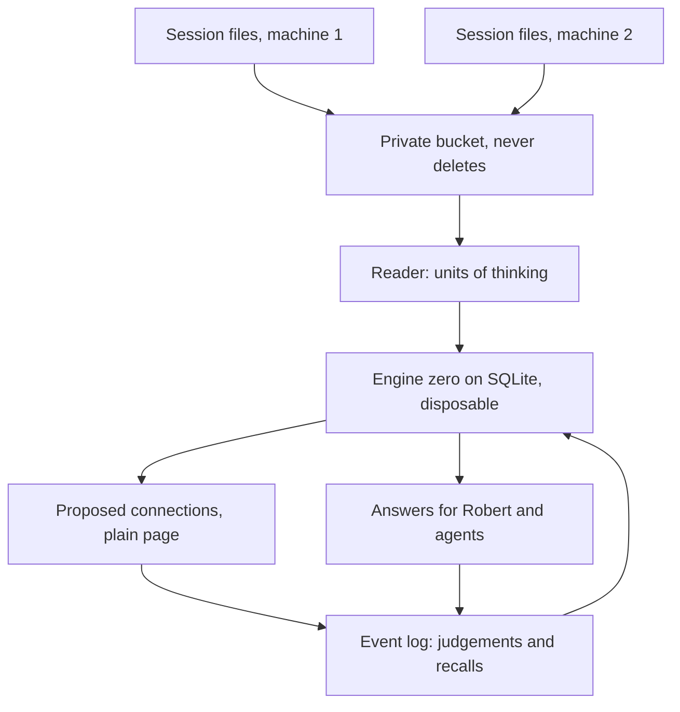

# Engine Zero - Plan

## Goal Capsule

- **Objective:** Connections between Robert's projects, which today exist only in Robert's head, are proposed by an agent from Robert's own agent sessions, judged by Robert, and kept. Nothing collected or judged is lost when the engine under it is replaced.
- **Means:** A throwaway first engine, written in Rust on SQLite, that reads agent session files from both of Robert's machines.
- **Product authority:** Robert. The agent proposes; Robert decides.
- **Open blockers:** None for planning.

---

## Product Contract

### Summary

Engine zero copies Robert's agent session files to one private bucket, reads them into units of thinking, stores them in SQLite, answers questions from Robert and their agents, and proposes connections across projects with evidence.
Robert judges each connection, and the judgements are kept in an event log outside the engine.
Its second job is to show which operations are slow or awkward, as evidence for a custom storage core.

### Problem Frame

Robert has returned to one need for about two and a half years, in more than a dozen forms: a place where they and an agent think together across all projects, where nothing starts from zero.
Each earlier attempt kept its data inside the tool and started empty, so nothing built up across months.
The full reading is in `wiki/the-problem.md`.

Agent sessions are where most of Robert's thinking now happens, and the tools that write them delete them: Claude Code removes session files after 30 days unless told otherwise.
On one machine, 18 days of work produced 2.2 GB of Claude Code sessions and 650 MB of Codex sessions.

### Key Decisions

- **The sources and the judgements live outside the engine, and every engine is disposable.** Each earlier attempt lost its data with its tool. Governs R2, R3, R9, R13. (session-settled: user-approved — chosen over keeping data inside the engine: the engine can then be replaced without a restart)
- **The source is agent session files from both machines, copied to one bucket.** They already exist, are already append-only, and need no filing. Governs R1. (session-settled: user-directed — chosen over a new hand-kept record: Robert proposed it because the data and its append-only form already exist)
- **SQLite first; a custom storage core later.** Governs R3. (session-settled: user-directed — chosen over starting a custom storage core now: a working engine on real data shows what the core must be good at)
- **The project writes its own reader. cass is neither a dependency nor a fork.** Governs R4. (session-settled: user-directed — chosen over running cass: it would become a dependency)
- **Written in Rust.** Robert's choice. The one cost raised: a throwaway engine is slower to change in Rust than in a scripting language. It stands because the reader and the unit types carry over to the next engine, which will also be Rust.
- **A model proposes; fixed rules decide.** A model that rewrites its own output drifts toward the generic, and fixed rules can be checked and repeated. Governs R11. Borrowed from cass-memory; see `wiki/existing-tools.md`.
- **No board in this version.** Robert judges connections on a plain page. Governs R12. (session-settled: user-approved — chosen over building shape B now: the board is drawn once there are connections worth drawing)

<!-- ce-section: work-relationships -->
### How This Work Fits Together

This plan covers engine zero only. The breakdown below is the current understanding, not a committed roadmap.

- Engine zero (this plan).
  - Enables: a custom storage core, designed from the slow and awkward operations engine zero records. Research so far is in `wiki/engine-research.md`.
  - Enables: memory behaviour, meaning fading and strengthening, computed from the recall and judgement events engine zero stores.
  - Enables: the visual views of shape B in `wiki/shape-options.md`, drawn from the same data.
  - Still to decide: further sources, such as repositories, the documents of earlier attempts, and notes written outside an agent.

### Actors

- A1. Robert: owns the data, asks questions, judges connections.
- A2. Robert's coding agents: ask the engine questions during their sessions.
- A3. Engine zero: copies, reads, stores, proposes.

### Requirements

**Keeping the sources**

- R1. Claude Code and Codex session files from both of Robert's machines are copied to one private bucket.
- R2. The copy never removes a file from the bucket. A file that has grown on the machine is updated; a file the machine has deleted stays.
- R3. The engine's database can be deleted and rebuilt from the bucket copy and the event log (R13) alone.

**Reading**

- R4. The project's own reader turns both session formats into one common form. It contains no code from cass.
- R5. Every item records who produced it, when, in which project, and the exact place in the source file it came from. "Who" separates the person, the agent, and text a tool inserted.
- R6. The reader extracts units of thinking: what the person said, decisions, and attempts. The unit kinds are those in `wiki/hand-run-test.md`.
- R7. Reading a source file again adds only what is new.

**Asking**

- R8. Robert and their agents can ask the engine questions from a command line and get items back, each with its pointer to the source.
- R9. Every item returned to a question is added to the event log (R13) as a recall event, with its time and who asked.

**Connecting**

- R10. The engine proposes connections between items from different projects. Each proposal states its kind, the items it joins, and its evidence as quotes with pointers to the source. The link kinds are those in `wiki/hand-run-test.md`.
- R11. A model proposes connections; fixed rules decide which are kept, merged or dropped. A proposal whose quoted evidence is not found in the sources is dropped.

**Judging**

- R12. Robert sees proposed connections on a plain page and marks each one as real and new, real and already known, or not real.
- R13. Each judgement is added as an event to the event log, which lives beside the bucket copy, outside the engine. Events are never edited.
- R14. A connection Robert marked not real is not proposed again.

**Privacy**

- R15. The bucket, the database and the event log are private and never enter the public repository. Test data in the repository contains no real session content.

### Key Flows

- F1. Collect and read
  - **Trigger:** A regular run on each machine.
  - **Actors:** A3
  - **Steps:** New and grown session files are copied to the bucket. The reader turns what is new into items and units.
  - **Covered by:** R1, R2, R4, R5, R6, R7
- F2. Propose connections
  - **Trigger:** A regular pass, or Robert asks for one.
  - **Actors:** A3
  - **Steps:** A model proposes connections across projects. Fixed rules check the evidence and keep, merge or drop each one. Kept proposals appear on the page.
  - **Covered by:** R10, R11, R14
- F3. Judge
  - **Trigger:** Robert opens the page.
  - **Actors:** A1
  - **Steps:** Robert reads a connection, opens its evidence if they wish, and marks it. The mark is added to the event log.
  - **Covered by:** R12, R13
- F4. Ask
  - **Trigger:** Robert or an agent has a question, for example at the start of a session.
  - **Actors:** A1, A2
  - **Steps:** The question goes to the engine. Items come back with source pointers. Each returned item is stored as a recall event.
  - **Covered by:** R8, R9
- F5. Rebuild
  - **Trigger:** The engine is replaced or its database is lost.
  - **Actors:** A1, A3
  - **Steps:** The database is built again from the bucket copy and the event log. Every judgement and every recall event is present afterwards.
  - **Covered by:** R3, R9, R13

### Acceptance Examples

- AE1. **Covers R2.** Given a session file is in the bucket, when that file is deleted from the machine and the copy runs again, the file is still in the bucket.
- AE2. **Covers R3, R9, R13.** Given Robert has judged ten connections and the engine has answered questions, when the database is deleted and rebuilt, all ten judgements and all recall events are present.
- AE3. **Covers R5.** Given a session where a tool inserted a report into the person's turn, when the reader runs, that report is not recorded as something the person said.
- AE4. **Covers R7.** Given a session file that has grown by three messages since it was last read, when the reader runs, exactly three items are added.
- AE5. **Covers R11.** Given a proposal that quotes text found in no source, when the rules run, the proposal is dropped and never reaches the page.
- AE6. **Covers R14.** Given a connection Robert marked not real, when a later pass proposes the same connection, it does not reach the page.

### Success Criteria

- The share of proposed connections Robert marks real and new is measured from the first pass. No target is set; the first pass gives the baseline.
- Robert is still using it 60 days after the first pass, having filed nothing by hand.
- Engine zero leaves a written list of the operations that were slow or awkward on real data.

### Scope Boundaries

Deferred for later:

- The board, timeline and status views of shape B.
- Fading and strengthening of memories. Engine zero only stores the events they will be computed from (R9, R13).
- Sources other than Claude Code and Codex sessions.
- A custom storage core.
- Removing secrets from session files before they are copied.
- Use from a phone or tablet.

Outside this product's identity:

- Rules that teach coding agents how to code. That is the problem cass-memory solves.
- A note-taking or personal knowledge management tool.
- More than one person's data.

### Dependencies / Assumptions

- Robert provides a private bucket and its credentials when the copy is built.
- Session files hold secrets and go to the bucket as they are. A private bucket is assumed to be enough.
- Claude Code's session retention is set to 100 years on the first machine, done on 15 November 2026. It must also be set on the second machine.
- It is unverified whether session files older than 30 days still exist on the second machine. The plan does not depend on them.
- It is unverified whether Codex deletes old session files.
- Both formats are JSON lines with different shapes, checked on one file of each on 16 November 2026.
- The project's north star is unconfirmed. These success criteria stand in for it.

### Outstanding Questions

Resolve Before Planning: none.

Deferred to Planning:

- Who runs the model step: one of Robert's coding agents calling the engine, or the engine calling a model service.
- How files reach the bucket from each machine.
- What form the plain page takes.
- What marks two items as being from different projects.
- Which fixed rules decide keep, merge and drop, beyond the evidence check in R11.

### Sources / Research

- `wiki/the-problem.md`: the need, why it recurs, the split between record, engine and view, and the size measurements.
- `wiki/hand-run-test.md`: unit kinds, link kinds, the operations that found connections by hand, and four tests.
- `wiki/existing-tools.md` and `raw/sources/2026-11-15-cass.md`: what cass and cass-memory do, the four ideas borrowed, and the licence rider that rules out copying their code.
- `wiki/engine-research.md`: research on engines and storage cores that engine zero's measurements feed.
- `wiki/memory-model.md`: the decision that the data is linked structure plus memory behaviour.
